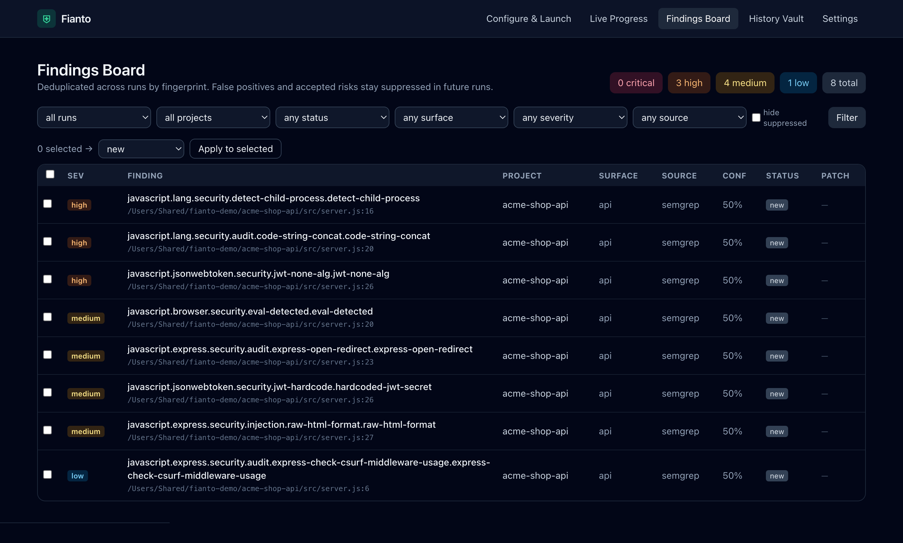
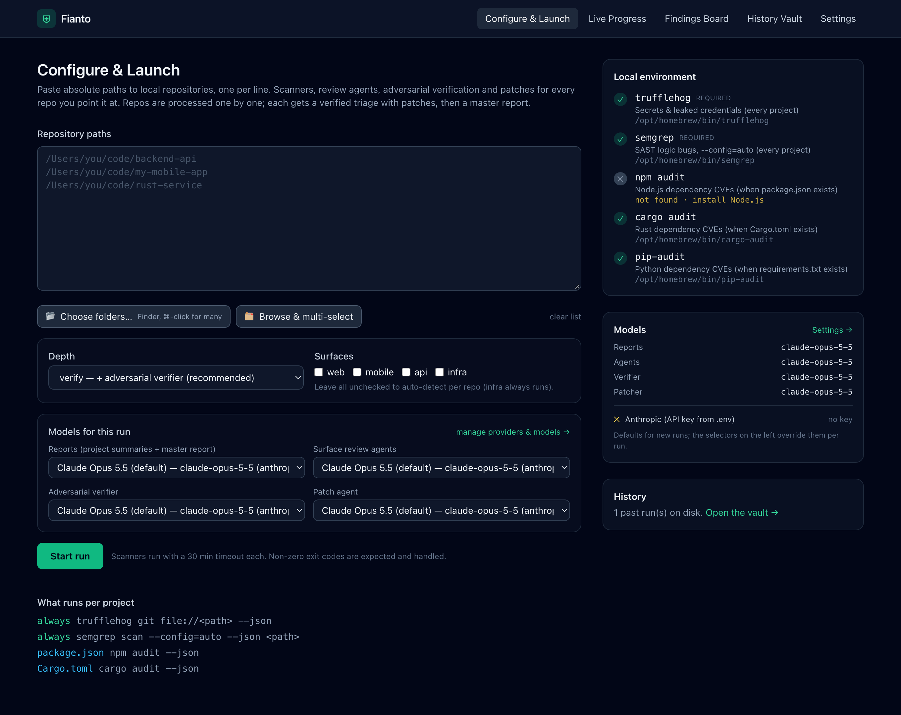
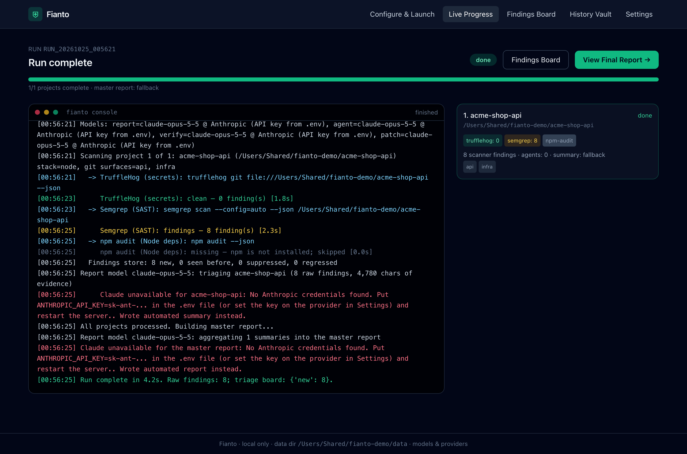
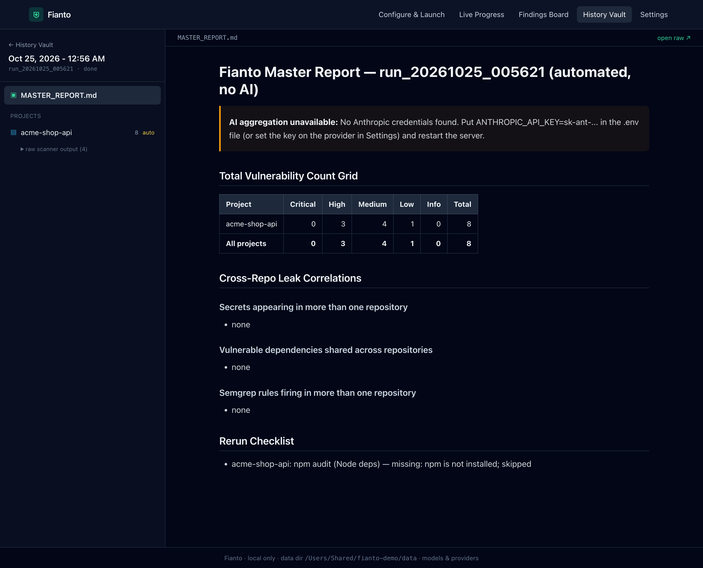

# Fianto

[](https://github.com/ravingupta/fianto/actions/workflows/ci.yml)
[](LICENSE)

[](CONTRIBUTING.md)

Fianto is a local AI security review platform. Point it at your repositories and it runs the scanners, sends
Claude agents with per-surface playbooks into the code, adversarially verifies what they find, patches confirmed
issues in isolated git worktrees, and keeps everything on a deduplicated triage board with one-click PRs.

FastAPI + Jinja2 · Tailwind via CDN · Anthropic Python SDK · SQLite. No build step.



<table>
  <tr>
    <td></td>
    <td></td>
    <td></td>
  </tr>
  <tr>
    <td align="center">Configure &amp; Launch</td>
    <td align="center">Live Progress</td>
    <td align="center">Report Hub</td>
  </tr>
</table>

<sub>Screenshots show a scan-only run (no AI) of a deliberately vulnerable sample app.</sub>

## Quick start

```bash
./setup_scanners.sh     # scanners, gh, ripgrep, Python venv, .env (idempotent)
# put ANTHROPIC_API_KEY=sk-ant-... in .env, or add a provider on the Settings page later
./run.sh                # http://127.0.0.1:8000
```

## How a run works

Each repository goes through the stages below, one repo at a time. Pick the depth on the launch page.

| Depth | Adds | Detail |
|---|---|---|
| `scan` | Scanners + reports | trufflehog, semgrep, `npm audit`, `cargo audit`, `pip-audit`, chosen by the files in the repo. Non-zero exit codes and missing tools never abort the queue. |
| `review` | Surface agents | One agent per detected surface (**web**, **mobile**, **api**, **infra**) runs in parallel with read-only repo tools and a playbook from [app/playbooks/](app/playbooks/). Findings carry file:line evidence, an exploit path, confidence and a patch hint. |
| `verify` | Adversarial verifier | A second agent tries to disprove every candidate against the code and records `confirmed`, `false_positive` or `needs_review` with reasoning. This is where dev-only CVEs and placeholder secrets get dropped. Recommended default. |
| `patch` | Patch agent | Confirmed High+ findings are fixed on branch `fianto/<id>` in `data/worktrees/`, with tests or type checks run before committing. Your checkout is never modified. |

Reports (`PROJECT_SUMMARY.md` per repo and `MASTER_REPORT.md` per run) are written last, with the verified triage as
their authoritative input: a count grid, cross-repo correlations, a P0/P1/P2 roadmap and a rerun checklist.

## Using the dashboard

| Page | What you do there |
|---|---|
| **Configure & Launch** `/` | Paste repo paths or pick folders (native Finder dialog on macOS, or the in-page multi-select browser). Choose depth, surfaces and the model for each stage. Shows which scanners are installed. |
| **Live Progress** `/run/status` | Console view of every scanner, agent tool call, verdict and patch as it happens (SSE). Links to the board and the final report. |
| **Findings Board** `/findings` | Every finding across runs, keyed by fingerprint. Filter by run, repo, surface, severity, source, status. Bulk status changes. |
| **Finding** `/findings/{id}` | Exploit path, evidence, verifier reasoning, patch diff. **Generate patch** and **Create PR** (push + `gh pr create`, only on click). |
| **History Vault** `/history` | Past runs, newest first; each opens the Report Hub with the master report, project summaries and raw scanner output. |
| **Settings** `/settings` | Providers, model roster, per-stage model assignment. |

Statuses: `new → needs_review → confirmed → fixed`. `false_positive` and `accepted_risk` suppress a fingerprint on
future runs; a `fixed` finding that comes back is marked regressed.

## Models and providers

Settings manages model sources without editing files. Supported providers:

- **Claude API** (API key, optional proxy base URL), **Claude on Amazon Bedrock** (AWS environment credentials),
  **Google Vertex AI** (Application Default Credentials), **Microsoft Foundry**.
- **OpenAI-compatible** endpoints: OpenAI (including Daybreak access), OpenRouter, Groq, Together, Ollama, vLLM.
  These run through function calling with the same repo tools, so every stage works on any model with tool support.

Per provider: **Discover** lists its models, **Test** proves the connection with a one-word completion. Per model:
adaptive thinking, effort, max tokens and the server-side refusal fallback (Claude API only). Assign a model to
each stage (reports, agents, verifier, patcher) and override per run from the launch page. A good split is Opus
for agents and reports and the most capable model you have (Fable 5.1, Mythos once approved) on the verifier.

Keys are stored in `data/settings.json`, which is git-ignored, and are only ever displayed as a hint.

## Configuration

Everything has a default; `.env` next to `run.sh` is read at startup. See [.env.example](.env.example) for the full list.

| Variable | Default | Purpose |
|---|---|---|
| `ANTHROPIC_API_KEY` | – | Key for the default Anthropic provider |
| `CLAUDE_MODEL` | `claude-opus-5-5` | Seed for the model roster on first start |
| `RUN_DEPTH` | `verify` | Default depth on the launch page |
| `AGENT_PARALLELISM` | `4` | Surface agents per repo run concurrently |
| `VERIFY_MAX_CANDIDATES` | `25` | Candidates per repo sent to the verifier |
| `PATCH_MAX_PER_PROJECT` / `PATCH_MIN_SEVERITY` | `3` / `high` | Auto-patch limits at depth `patch` |
| `SCANNER_TIMEOUT_SECONDS` | `1800` | Per scanner |
| `SCANNER_DATA_DIR` | `./data` | Runs, findings database, worktrees, settings |
| `APP_NAME` | `Fianto` | Display name |

## Project layout

```
app/            FastAPI app, run manager, scanners, agents, store, providers   (see docs/ARCHITECTURE.md)
app/playbooks/  per-surface agent instructions
templates/      server-rendered pages
docs/           architecture notes and the original build spec
data/           runs, findings.db, worktrees, settings.json   (git-ignored)
```

## Safety notes

- The patch agent can run allow-listed programs (including `npm install` and `node -e`) inside its worktree. Treat it
  like a junior engineer with a shell in a scratch clone and review diffs before opening PRs.
- Raw `trufflehog.json` files contain real secret values. Reports and the board only ever show a 4-character prefix.
- Every model call opts into the server-side refusal fallback where supported, so a safety-classifier decline on
  exploit content is retried on a fallback model and the run continues. If no model is reachable at all, the run
  still completes with clearly labelled automated summaries.

## Responsible use

Fianto is for reviewing code you own or are authorized to test. Repository contents are sent to the model
provider you configure. Check that this is allowed for the code you scan. Everything else (findings, reports,
keys) stays on your machine under `data/`, which is git-ignored. Never commit it or attach it to an issue.

## Contributing

Issues and pull requests are welcome! Start with [CONTRIBUTING.md](CONTRIBUTING.md). Improving the
[playbooks](app/playbooks/) and adding scanners are good first contributions. Please follow the
[Code of Conduct](CODE_OF_CONDUCT.md), and report vulnerabilities in Fianto privately as described in
[SECURITY.md](SECURITY.md).

## License

[MIT](LICENSE) © Ravin Gupta
